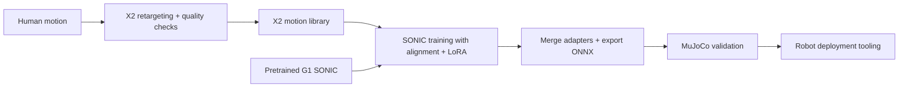

<div align="center">

# Sonic2AgiX2

### Bring SONIC's whole-body control to AgiBot X2.

**Unitree G1 → AgiBot X2 Ultra · Kinematic alignment + LoRA · MuJoCo validation**

[](LICENSE)
[](https://arxiv.org/abs/2605.23733)
[](sim2sim/README.md)

[English](README.md) · [简体中文](README.zh-CN.md) · [Getting started](#getting-started) · [Engineering notes](#engineering-notes)


**Walk → bow.** Closed-loop policy in MuJoCo (left), motion reference (right).

</div>

Sonic2AgiX2 adapts NVIDIA's **GEAR-SONIC** controller, pretrained for the 29-DoF Unitree G1, to the **31-DoF AgiBot X2 Ultra**. It is an independent implementation of the [Any2Any](https://arxiv.org/abs/2605.23733) approach: align the robots' kinematics, then adapt the actor dynamics decoder and critic with LoRA.

The repository brings together the engineering around that transfer: **human-motion retargeting, policy adaptation, simulation validation, and robot deployment tooling**. It also records the mapping and observation bugs that can quietly break a cross-robot transfer.

> **Release scope:** This is a source-code overlay for an external SONIC/GMR workspace. Model weights, robot assets, motion datasets, and captured evaluation artifacts are not bundled. See [requirements](#what-you-need) before running a demo or starting training.

## Highlights

- **Reuse a pretrained controller across robot bodies.** G1↔X2 joint-space alignment handles ordering, semantic wrist pairing, and calibrated zero-pose offsets; LoRA targets the actor dynamics decoder and critic.
- **Turn human motion into X2 references.** AMASS, LAFAN, OMOMO, and 100STYLE batch entry points, calibrated GMR configurations, and per-clip quality checks.
- **Inspect control in MuJoCo.** ONNX inference, side-by-side reference rendering, and observation checks against captured Isaac Lab ground truth—without running Isaac Sim for playback.
- **Drive X2 with a keyboard.** Planner-based WASD teleoperation, walk/run modes, and an optional human gait-cycle reference.
- **Follow the deployment path.** Export and packing utilities, numerical test vectors, dry-run bridges, joystick tooling, and a C++ reference-source example.
- **Learn from the failure cases.** A transfer checklist and debugging log covering joint semantics, observation layouts, action scaling, and data curation.

## Reported results

The existing project release notes report the following **v21** tracking results:

| Evaluation set | Reported success rate |
|---|---:|
| OMOMO | **97.0%** |
| LAFAN | **72.9%** |

These are project-reported results, not measurements rerun from this source release. The matching checkpoints, complete evaluation protocol, and raw logs are not included here; the numbers should not be treated as a directly reproducible benchmark or a comparison against other methods. The GIF above demonstrates a MuJoCo rollout, not a hardware trial.

## How it works



**Alignment** translates X2 observations into the source policy's joint conventions and maps actions back. **LoRA** adapts dynamics-sensitive modules while preserving the frozen pretrained backbone. **Validation** checks the observation and action interface before evaluating closed-loop behavior.

## Getting started

### What you need

| Your goal | External dependencies and assets |
|---|---|
| Read or reuse the transfer code | This repository; start with the [code map](#code-map) |
| Run interactive MuJoCo teleoperation | Python dependencies, a compatible X2 policy ONNX, SONIC planner ONNX, and X2 MJCF with meshes |
| Validate observations / replay a recorded motion | Matching Isaac Lab capture files and retargeted motion clips, in addition to the relevant policy and robot assets |
| Retarget human motion | Patched [GMR](https://github.com/YanjieZe/GMR), X2 assets, and the source datasets/body models required by your input format |
| Train or export a policy | [GR00T-WholeBodyControl](https://github.com/NVlabs/GR00T-WholeBodyControl), its Isaac Sim / Isaac Lab environment, an NVIDIA GPU, base weights, retargeted data, and X2 trainer integration |

Obtain weights, datasets, SMPL-X models, and robot descriptions from their respective providers under their own terms. This repository's code license does not grant rights to those assets.

### 1. Prepare the workspace

Several scripts expect the external repositories to be siblings:

```text
workspace/
├── Sonic2AgiX2/               # this repository
├── GR00T-WholeBodyControl/    # SONIC trainer and upstream assets
└── GMR/                      # retargeter and separately obtained X2 assets
```

From your chosen workspace directory:

```bash
git clone https://github.com/TaiE64/Sonic2AgiX2.git
git clone https://github.com/NVlabs/GR00T-WholeBodyControl.git
git clone https://github.com/YanjieZe/GMR.git

export SONIC2X2_ROOT="$PWD/Sonic2AgiX2"
export GROOT_ROOT="$PWD/GR00T-WholeBodyControl"
export PYTHONPATH="$SONIC2X2_ROOT/retarget:$SONIC2X2_ROOT/any2any_train${PYTHONPATH:+:$PYTHONPATH}"
```

The `PYTHONPATH` entries expose modules moved into subdirectories in this source release. Keep them set when using the commands below. `GROOT_ROOT` is a shell convenience here; some scripts still use sibling-relative or author-workspace paths.

### 2. Choose your entry point

**Have compatible ONNX models and X2 assets?** Follow the [MuJoCo demo guide](sim2sim/README.md) for explicit model paths, keyboard controls, and validation requirements. Interactive inference uses MuJoCo and ONNX Runtime; it does not require Isaac Sim or PyTorch.

**Working on retargeting?** Apply the GMR changes against the revision recorded in [gmr_x2_overlay/UPSTREAM](gmr_x2_overlay/UPSTREAM), following the [overlay guide](gmr_x2_overlay/README.md). Then inspect [retarget/](retarget/) for the input-format-specific batch entry point and QC settings.

**Integrating training?** Install the upstream trainer according to its instructions, then copy in the X2 robot configuration:

```bash
cp "$SONIC2X2_ROOT/gear_sonic_x2_overlay/x2.py" \
   "$GROOT_ROOT/gear_sonic/envs/manager_env/robots/x2.py"
```

This installs the robot configuration only. Connect the alignment wrapper and LoRA modules to your trainer, configure the motion library and experiment, and review the [transfer checklist](docs/CHECKLIST.md). The release does not include a complete, portable training recipe; copying `x2.py` alone does not reproduce v21.

### 3. Follow the transfer pipeline

| Stage | Entry points |
|---|---|
| Retarget and curate | [retarget/](retarget/), [data_manifests/](data_manifests/) |
| Build the motion library | [convert_x2_to_motion_lib.py](any2any_train/convert_x2_to_motion_lib.py), [build_mixed_motion_lib.py](any2any_train/build_mixed_motion_lib.py) |
| Align and adapt | [aligned_env.py](any2any_train/aligned_env.py), [lora.py](any2any_train/lora.py), [wire_sonic_lora.py](any2any_train/wire_sonic_lora.py) |
| Merge and export | [merge_lora_checkpoint.py](any2any_train/merge_lora_checkpoint.py), then the upstream trainer's ONNX exporter |
| Validate and visualize | [mujoco_sim2sim_x2.py](sim2sim/mujoco_sim2sim_x2.py), [MuJoCo guide](sim2sim/README.md) |
| Prepare deployment | [deploy_x2/](deploy_x2/), [planner_refsrc_x2.py](sim2sim/planner_refsrc_x2.py) |

## Code map

```text
any2any_train/          Alignment wrappers, LoRA, checkpoint merging, motion libraries
retarget/              Retargeting, kinematic mappings, calibration, per-clip QC
sim2sim/               MuJoCo validation, ONNX playback, planner and keyboard teleop
gmr_x2_overlay/        GMR patch, upstream revision, calibrated X2 IK configurations
gear_sonic_x2_overlay/ X2 robot and tracking configuration for the SONIC trainer
deploy_x2/             Deployment bundles, test vectors, bridges, reference-source example
data_manifests/        Clip-name lists for training-data curation; no motion data
docs/                  Transfer checklist, debugging record, retargeting notes
media/                 Walk-to-bow demonstration
```

## Engineering notes

Transferring a policy requires agreement on much more than joint count. These notes explain what failed and how it was diagnosed:

- [Cross-robot transfer checklist](docs/CHECKLIST.md) — index maps, semantic joint pairing, observation contracts, soft limits, and independent validation.
- [Bugs and fixes](docs/BUGS_AND_FIXES.md) — debugging evidence and the consequences of subtle mapping errors.
- [Retargeting notes](docs/RETARGET_NOTES.md) — solver design and historical validation constraints.

The detailed engineering notes are primarily in Chinese. They preserve historical workspace paths and version-specific observations; use the current code and the public-release setup above when integrating this checkout.

## Contributing

Useful contributions include reproducible bug reports, portable setup improvements, evaluation scripts, and additional robot mappings. For an issue, include the commit, environment, relevant command, and a minimal log or example. Keep third-party weights and restricted datasets out of submissions.

If this helps your humanoid-control work, **give the repository a star** and share what you build. Cross-robot transfer reports—especially the failure cases—are welcome in [Issues](https://github.com/TaiE64/Sonic2AgiX2/issues).

## Acknowledgements and license

Built on [Any2Any](https://arxiv.org/abs/2605.23733), NVIDIA's [GR00T-WholeBodyControl / GEAR-SONIC](https://github.com/NVlabs/GR00T-WholeBodyControl), and [GMR](https://github.com/YanjieZe/GMR). This is an independent project, not an official release from those teams.

Code in this repository is released under [Apache-2.0](LICENSE), subject to retained upstream notices. External repositories, model weights, datasets, and robot assets retain their own licenses.
